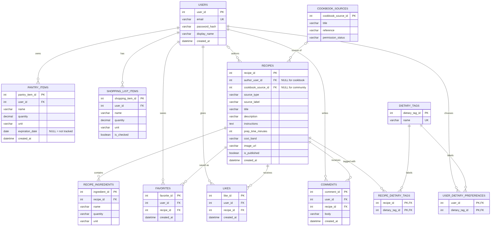

# Cooking Nexus - Database Handoff

| | |
|---|---|
| Project | Cooking Nexus (Team Nexus, CSI 2999) |
| Database owner | Nafis Shohid |
| Audience | Backend developer (FastAPI) |
| Version | 1.0 |
| Date | November 7, 2026 |
| Database system | MySQL 8.0 (tested on 8.0.46) |
| Database name | `cooking_nexus` |

This document tells you everything you need to connect the FastAPI backend to the database. All SQL referred to here is in the `sql/` folder of this package, and every query in section 9 was tested against the sample data.

**Contents**

1. Database overview
2. ER diagram
3. Table definitions
4. Column descriptions and data types
5. Primary and foreign keys
6. Relationships
7. SQL creation scripts
8. Sample data
9. Important queries
10. Connecting to the database
11. Rules the backend must follow
12. Open questions and how to change the schema

---

## 1. Database overview

The database stores everything the frontend needs to persist between sessions: accounts, each user's private pantry, favorites and shopping list, cookbook recipes, and the community layer (user-written recipes, likes, comments).

It has **12 tables**.

| Group | Tables |
|---|---|
| Accounts | `users`, `user_dietary_preferences` |
| Pantry | `pantry_items` |
| Recipes | `cookbook_sources`, `recipes`, `recipe_ingredients`, `dietary_tags`, `recipe_dietary_tags` |
| Private lists | `favorites`, `shopping_list_items` |
| Community | `likes`, `comments` |

**Key design decisions**

- **One `recipes` table holds both cookbook recipes and community recipes.** `source_type` says which. Cookbook rows have a `cookbook_source_id` and no author. Community rows have an `author_user_id` and no source.
- **Things that can be calculated are not stored.** The database has no columns for pantry expiration status, like counts, comment counts, "liked by me", or "you have 3/5 ingredients". Queries compute them (section 9), so they can never go out of date.
- **`pantry_items.expiration_date` is nullable.** `NULL` means "Not tracked". The system never invents a date.
- **Dietary tags live in their own tables**, not in a text or JSON column. The same list of tags is used for recipes and for a user's profile preferences.
- **"Fast" and "Low-cost" are not tags.** They come from `prep_time_minutes <= 30` and `cost_band = 'low'`.
- **Instructions are one text value, one step per line.** The backend splits on newlines when building the API's `instructions` array.
- **Login sessions are not stored.** The JWT lives in an HttpOnly cookie, so there is no sessions table.

---

## 2. ER diagram



(`PK` = primary key, `FK` = foreign key, `UK` = unique.)

---

## 3. Table definitions

| Table | Purpose |
|---|---|
| `users` | One row per account |
| `user_dietary_preferences` | Which dietary tags a user chose on the Profile page |
| `pantry_items` | A user's private pantry |
| `cookbook_sources` | Where cookbook recipes came from (provenance and permission) |
| `recipes` | Cookbook recipes and community recipes (including drafts) |
| `recipe_ingredients` | The ingredients of each recipe |
| `dietary_tags` | The fixed list of tags (Vegetarian, Vegan, Gluten-free, Dairy-free) |
| `recipe_dietary_tags` | Which tags each recipe has (link table) |
| `favorites` | A user's private recipe bookmarks |
| `shopping_list_items` | A user's private shopping list |
| `likes` | Public likes on recipes (one per user per recipe) |
| `comments` | Comments on recipes |

---

## 4. Column descriptions and data types

`PK` primary key, `FK` foreign key, `NN` NOT NULL, `UQ` unique. All `*_id` primary keys are `INT AUTO_INCREMENT`.

### users
| Column | Type | Notes |
|---|---|---|
| `user_id` | INT | PK |
| `email` | VARCHAR(255) | NN, UQ. Comparison is case-insensitive |
| `password_hash` | VARCHAR(255) | NN. Store the hash only, never the password |
| `display_name` | VARCHAR(50) | NN. The SDD suggests 2-50 characters |
| `created_at` | DATETIME | NN, default current time |

### user_dietary_preferences
| Column | Type | Notes |
|---|---|---|
| `user_id` | INT | PK (part 1), FK to `users` |
| `dietary_tag_id` | INT | PK (part 2), FK to `dietary_tags` |

### pantry_items
| Column | Type | Notes |
|---|---|---|
| `pantry_item_id` | INT | PK |
| `user_id` | INT | NN, FK to `users` (owner) |
| `name` | VARCHAR(100) | NN |
| `quantity` | DECIMAL(10,2) | NN, must be >= 0 (decimals such as 1.5 are allowed) |
| `unit` | VARCHAR(20) | optional |
| `expiration_date` | DATE | optional. `NULL` = Not tracked |
| `created_at` | DATETIME | NN, default current time |

### cookbook_sources
| Column | Type | Notes |
|---|---|---|
| `cookbook_source_id` | INT | PK |
| `title` | VARCHAR(150) | NN |
| `reference` | VARCHAR(255) | optional |
| `permission_status` | VARCHAR(30) | NN, default `'permitted'` |

### recipes
| Column | Type | Notes |
|---|---|---|
| `recipe_id` | INT | PK |
| `author_user_id` | INT | FK to `users`. Set for community recipes, `NULL` for cookbook |
| `cookbook_source_id` | INT | FK to `cookbook_sources`. Set for cookbook recipes, `NULL` for community |
| `source_type` | ENUM('cookbook','community') | NN |
| `source_label` | VARCHAR(150) | optional. Text shown on cards, e.g. "Cookbook A - page 42" |
| `title` | VARCHAR(120) | NN |
| `description` | VARCHAR(700) | optional |
| `instructions` | TEXT | NN. One step per line |
| `prep_time_minutes` | SMALLINT | optional. 1-999 |
| `cost_band` | ENUM('low','medium','high') | optional. `'low'` powers the Budget filter |
| `image_url` | VARCHAR(255) | optional. A path or URL, e.g. `/images/pasta.jpg`. The image itself is not stored in the database |
| `is_published` | BOOLEAN | NN, default FALSE. FALSE = private draft |
| `created_at` | DATETIME | NN, default current time |

### recipe_ingredients
| Column | Type | Notes |
|---|---|---|
| `ingredient_id` | INT | PK |
| `recipe_id` | INT | NN, FK to `recipes` |
| `name` | VARCHAR(100) | NN. Unique together with `recipe_id` |
| `quantity` | VARCHAR(30) | optional, text (e.g. "1 1/2") |
| `unit` | VARCHAR(20) | optional |

### dietary_tags
| Column | Type | Notes |
|---|---|---|
| `dietary_tag_id` | INT | PK |
| `name` | VARCHAR(40) | NN, UQ |

### recipe_dietary_tags
| Column | Type | Notes |
|---|---|---|
| `recipe_id` | INT | PK (part 1), FK to `recipes` |
| `dietary_tag_id` | INT | PK (part 2), FK to `dietary_tags` |

### favorites
| Column | Type | Notes |
|---|---|---|
| `favorite_id` | INT | PK |
| `user_id` | INT | NN, FK to `users` |
| `recipe_id` | INT | NN, FK to `recipes` |
| `created_at` | DATETIME | NN, default current time |

Unique on (`user_id`, `recipe_id`).

### shopping_list_items
| Column | Type | Notes |
|---|---|---|
| `shopping_item_id` | INT | PK |
| `user_id` | INT | NN, FK to `users` |
| `name` | VARCHAR(100) | NN |
| `quantity` | DECIMAL(10,2) | NN, default 1, must be > 0 |
| `unit` | VARCHAR(20) | optional |
| `is_checked` | BOOLEAN | NN, default FALSE |

### likes
| Column | Type | Notes |
|---|---|---|
| `like_id` | INT | PK |
| `user_id` | INT | NN, FK to `users` |
| `recipe_id` | INT | NN, FK to `recipes` |
| `created_at` | DATETIME | NN, default current time |

Unique on (`user_id`, `recipe_id`).

### comments
| Column | Type | Notes |
|---|---|---|
| `comment_id` | INT | PK |
| `user_id` | INT | NN, FK to `users` |
| `recipe_id` | INT | NN, FK to `recipes` |
| `body` | VARCHAR(500) | NN, 1-500 characters |
| `created_at` | DATETIME | NN, default current time |

### Indexes beyond the automatic ones
MySQL automatically indexes every primary key, unique rule, and foreign key. Three more were added (file `03_indexes.sql`):

| Index | Columns | Used for |
|---|---|---|
| `idx_recipes_feed` | `recipes (source_type, is_published, created_at)` | community feed |
| `idx_comments_recipe_created` | `comments (recipe_id, created_at)` | comments under a post |
| `idx_shopping_user_checked` | `shopping_list_items (user_id, is_checked)` | shopping list |

---

## 5. Primary and foreign keys

| Table | Primary key | Foreign keys | On delete |
|---|---|---|---|
| `users` | `user_id` | | |
| `user_dietary_preferences` | (`user_id`, `dietary_tag_id`) | `user_id` to `users`; `dietary_tag_id` to `dietary_tags` | CASCADE both |
| `pantry_items` | `pantry_item_id` | `user_id` to `users` | CASCADE |
| `cookbook_sources` | `cookbook_source_id` | | |
| `recipes` | `recipe_id` | `author_user_id` to `users`; `cookbook_source_id` to `cookbook_sources` | **RESTRICT** both |
| `recipe_ingredients` | `ingredient_id` | `recipe_id` to `recipes` | CASCADE |
| `dietary_tags` | `dietary_tag_id` | | |
| `recipe_dietary_tags` | (`recipe_id`, `dietary_tag_id`) | `recipe_id` to `recipes`; `dietary_tag_id` to `dietary_tags` | CASCADE both |
| `favorites` | `favorite_id` | `user_id` to `users`; `recipe_id` to `recipes` | CASCADE both |
| `shopping_list_items` | `shopping_item_id` | `user_id` to `users` | CASCADE |
| `likes` | `like_id` | `user_id` to `users`; `recipe_id` to `recipes` | CASCADE both |
| `comments` | `comment_id` | `user_id` to `users`; `recipe_id` to `recipes` | CASCADE both |

**What the delete rules mean**

- **CASCADE:** deleting the parent row automatically deletes the child rows. Deleting a recipe removes its ingredients, tags, likes, comments, and favorites. Deleting a user removes their pantry, shopping list, favorites, likes, and comments.
- **RESTRICT** (on `recipes.author_user_id` and `recipes.cookbook_source_id`): MySQL **refuses** to delete a user or cookbook source that still has recipes (error 1451). This protects community content, and the SDD says account deletion is not part of the MVP.

---

## 6. Relationships

| Relationship | Type | Notes |
|---|---|---|
| user - pantry items | one-to-many | one owner per item |
| user - shopping list items | one-to-many | |
| user - recipes (authored) | one-to-many | optional: cookbook recipes have no author |
| cookbook source - recipes | one-to-many | optional: community recipes have no source |
| recipe - ingredients | one-to-many | |
| user - recipes (favorites) | many-to-many | link table `favorites` |
| user - recipes (likes) | many-to-many | link table `likes` |
| user - recipes (comments) | many-to-many with data | `comments` rows carry a body |
| recipe - dietary tags | many-to-many | link table `recipe_dietary_tags` |
| user - dietary tags (preferences) | many-to-many | link table `user_dietary_preferences` |

---

## 7. SQL creation scripts

All scripts are in `sql/` and must be run **in this order**:

| File | Purpose |
|---|---|
| `01_create_database.sql` | Creates the database and the limited `nexus_app` user |
| `02_create_tables.sql` | Creates the 12 tables (order matters) |
| `03_indexes.sql` | Creates the 3 extra indexes |
| `04_seed_data.sql` | Loads sample data (section 8) |
| `05_queries.sql` | The query reference for your endpoints (section 9) |
| `06_tests.sql` | 12 checks proving the rules work (privacy, drafts, filters, constraints) |
| `99_reset.sql` | Deletes the whole database so you can start over |

**To build a fresh database (MySQL Workbench):** open each file with **File > Open SQL Script**, select nothing, and click the lightning bolt. Run 01, then 02, 03, 04, in order.

**To start over:** run `99_reset.sql`, then 01 to 04 again.

**From the command line** (if `mysql` is on your PATH):

```
mysql -u root -p < sql/01_create_database.sql
mysql -u root -p < sql/02_create_tables.sql
mysql -u root -p < sql/03_indexes.sql
mysql -u root -p < sql/04_seed_data.sql
```

`schema_export.sql` (in the package root) is a one-file snapshot of the structure and sample data, made with MySQL Workbench's Data Export. **The files in `sql/` are the source of truth.** If they ever disagree with the snapshot, use `sql/`.

---

## 8. Sample data

`04_seed_data.sql` is based on the frontend's `src/demo/seed.js`. IDs are explicit, so they are the same on every machine.

| Table | Rows | Contents |
|---|---|---|
| `users` | 4 | 1 Demo Cook, 2 Alex, 3 Morgan, 4 Jordan |
| `dietary_tags` | 4 | Vegetarian, Vegan, Gluten-free, Dairy-free |
| `cookbook_sources` | 1 | "Sample Cookbook (demo only)" |
| `recipes` | 10 | 1-6 cookbook; 7-9 published community (Alex, Morgan, Jordan); 10 a private draft by Demo Cook |
| `recipe_ingredients` | 41 | |
| `recipe_dietary_tags` | 18 | |
| `pantry_items` | 8 | 7 for Demo Cook (one expired, two expiring soon, one with no date) and 1 for Alex |
| `user_dietary_preferences` | 1 | Alex: Vegan |
| `favorites` | 3 | |
| `shopping_list_items` | 3 | |
| `likes` | 5 | |
| `comments` | 1 | |

**Important:** all seed users have `password_hash = 'FAKE_HASH_demo_only'`. **They cannot log in** through your real login endpoint. Either register a new account through the API, or replace a seed user's hash with one produced by your hashing library. Pantry expiration dates are relative to the day the script runs (`CURDATE()`), so they always look current.

---

## 9. Important queries

`sql/05_queries.sql` has 38 numbered queries, each with a comment naming its endpoint. In it, `@user_id` stands in for the logged-in user, and `@name`, `@recipe_id` and so on stand in for request values. In your code, replace them with bound parameters.

| Endpoint | Query |
|---|---|
| `POST /auth/register` | Q01 |
| `POST /auth/login` | Q02 |
| `GET /me` | Q03 (profile), Q04 (dietary preferences) |
| `PATCH /me` | Q05 (display name), Q06 (replace preferences) |
| `GET /pantry` | Q07 (includes calculated status) |
| `POST /pantry` | Q08 |
| `PATCH /pantry/{id}` | Q09 (edit), Q10 ("Use item") |
| `DELETE /pantry/{id}` | Q11 |
| Dashboard | Q12 (expiring soon), Q13 (summary numbers) |
| `POST /recipes/discover` | Q14 (search, quick, budget, pantry match), Q15 (with dietary tags) |
| `GET /recipes/{id}` | Q16 (recipe), Q17 (ingredients), Q18 (tags), Q19 (missing ingredients) |
| `GET /favorites` | Q20 |
| `POST /favorites/{recipeId}` | Q21 |
| `DELETE /favorites/{recipeId}` | Q22 |
| `GET /shopping-list` | Q23 |
| `POST /shopping-list` | Q24 |
| `PATCH /shopping-list/{id}` | Q25 |
| `DELETE /shopping-list/{id}` | Q26 |
| "Add missing ingredients" | Q27 (or call Q24 once per ingredient, as the frontend does) |
| `GET /community/recipes` | Q28 |
| `GET /community/recipes/mine` | Q29 (**an extra endpoint the frontend needs**; see section 12) |
| Comments under a post | Q30 |
| `POST /community/recipes` | Q31 (draft, ingredients, tags: one transaction) |
| `PATCH /community/recipes/{id}` | Q32 |
| `POST /community/recipes/{id}/publish` | Q33 |
| `DELETE /community/recipes/{id}` | Q34 |
| `POST` / `DELETE .../like` | Q35 / Q36 |
| `POST .../comments` | Q37 |
| `DELETE /comments/{id}` | Q38 |

The queries return `AS id` where the frontend's JSON expects `id` (the database's own column names are `pantry_item_id`, `recipe_id`, and so on).

---

## 10. Connecting to the database

| Setting | Value |
|---|---|
| Host | `127.0.0.1` (or `localhost`) |
| Port | `3306` |
| Database | `cooking_nexus` |
| Username | `nexus_app` |
| Password | `Pas3Word!` |
| Character set | `utf8mb4` |

Each developer runs **their own local copy** of the database, as the SDD plans. The user `nexus_app` is created with `'localhost'`, so it only accepts connections from the same computer.

**Example SQLAlchemy URL** (the PyMySQL driver is only an example; use whichever you chose):

```
mysql+pymysql://nexus_app:<PASSWORD>@127.0.0.1:3306/cooking_nexus?charset=utf8mb4
```

If the password contains special characters, URL-encode them in this string (for example `!` becomes `%21`).

**Keep credentials out of the repository.** Put the URL in a `.env` file that is excluded from Git, for example `DATABASE_URL=...`, and read it from the environment, as SDD section 7.1 requires.

**What `nexus_app` is allowed to do:** `SELECT`, `INSERT`, `UPDATE`, `DELETE` on `cooking_nexus` only. It **cannot** create, alter, or drop tables. That is deliberate, so a backend bug cannot destroy the schema. If you want Alembic to run migrations, see the open questions in section 12.

---

## 11. Rules the backend must follow

These come from the SDD (sections 4 and 7). The queries in `05_queries.sql` already follow them. Please keep to them when adapting the queries.

1. **The user ID comes from the auth cookie, never from the request body.** Every private query has `user_id = <current user>` in its `WHERE`.
2. **A write that affects 0 rows means "not found or not yours".** Return 404, as the SDD prefers, so that private IDs are not revealed.
3. **Handle MySQL error 1062 (duplicate)** for email, favorites, and likes, and return a friendly "already exists" response, not a 500.
4. **Handle error 1451** if account deletion is ever added (a user who authored recipes cannot be deleted while those recipes exist).
5. **Use parameterized queries only.** Never build SQL by concatenating user input.
6. **Wrap multi-step actions in one transaction:** creating or editing a recipe together with its ingredients and tags, and replacing a user's dietary preferences.
7. **Likes and comments are only allowed on published community recipes.** Q35 and Q37 enforce this in SQL (0 rows affected = reject).
8. **Drafts are private.** Every query that returns recipes to a user filters with `is_published = TRUE OR author_user_id = <current user>` (see Q16, Q20, Q21). Q29 returns only the author's own recipes.
9. **The database stores no passwords, only hashes**, produced by your hashing library.

---

## 12. Open questions and how to change the schema

### Decisions to settle together

| # | Question | Current state / suggestion |
|---|---|---|
| 1 | **Who owns the schema?** The SDD proposes SQLAlchemy models plus Alembic migrations. | Suggest the `sql/` files are the source of truth and your models match them. If you prefer to generate the tables from models, we need to agree on one direction. |
| 2 | **Which database user runs migrations?** `nexus_app` cannot alter tables. | If you use Alembic, create a second user with schema privileges, or use `root` locally. |
| 3 | **Ingredient name matching.** The frontend treats "Tomato" and "Tomatoes" as the same (it strips a trailing "s"/"es"). The SQL compares names case-insensitively but exactly. | Option A: backend normalizes names before querying. Option B: add a `normalized_name` column. Decide before discovery relies on it. |
| 4 | **`cost_band` values.** The SDD leaves "low-cost" undefined. | `low`, `medium`, `high` for now. The Budget filter uses `low`. |
| 5 | **Cookbook ingestion.** How will cookbook recipes get into the database? | Needs an import script that writes `cookbook_sources`, `recipes`, `recipe_ingredients`, and `recipe_dietary_tags`, and fills `source_label` (e.g. "Cookbook A - page 42"). |
| 6 | **Pagination** of the community feed and discovery results. | Add `LIMIT`/`OFFSET` (numbers) to Q14 and Q28 when needed. |
| 7 | **Images.** | Only a path or URL goes in `recipes.image_url`. AI-generated or uploaded images are stored as files, with the path saved here. |

### Additions beyond the original SDD (the frontend needs these)

- `user_dietary_preferences` table, for `GET /me` and `PATCH /me` with `dietary_preferences`.
- `recipes.image_url` and `recipes.source_label` columns.
- A separate `dietary_tags` list and `recipe_dietary_tags` link table (the SDD's draft stored tags as JSON inside `recipes`).
- `GET /community/recipes/mine` (**an extra API endpoint**, needs Q29), so a user can see their drafts.
- A uniqueness rule on (`recipe_id`, `name`) in `recipe_ingredients`.

### How to change the schema

1. Agree on the change before either of us edits anything.
2. Nafis edits `02_create_tables.sql` (or `03_indexes.sql`) and the seed file if needed, then runs `99_reset.sql` and 01 to 04 to confirm it rebuilds cleanly.
3. Run `06_tests.sql` and check that every test still gives its expected result.
4. Update this document, send the files, and re-export `schema_export.sql`.
5. The backend developer pulls the files and updates the models.

---

*End of handoff document.*
